<div align="center">

# 🎓 Student Dropout Prediction

### AI-powered early-warning system that estimates a student's risk of dropping out


<br>


<sub><i>The Streamlit application: enter a student's details and get a dropout probability, a risk level and a risk guide.</i></sub>

</div>

---

## 📑 Table of Contents

1. [Introduction](#-introduction)
2. [Problem Statement & Objectives](#-problem-statement--objectives)
3. [Dataset](#-dataset)
4. [Data Cleaning & Preprocessing](#-data-cleaning--preprocessing)
5. [Exploratory Data Analysis](#-exploratory-data-analysis-eda)
6. [Selected Algorithm: Logistic Regression](#-selected-algorithm-logistic-regression)
7. [Binary Classification Approach](#-binary-classification-approach)
8. [Model Training (80/20 Split)](#-model-training-8020-split)
9. [Model Evaluation](#-model-evaluation)
10. [Student Risk Prediction Application](#-student-risk-prediction-application)
11. [Installation & Running the App](#-installation--running-the-app)
12. [Project Structure](#-project-structure)
13. [Screenshots](#-screenshots)
14. [Conclusion & Future Improvements](#-conclusion--future-improvements)

---

## 📌 Introduction

Student dropout is one of the most costly problems in higher education, both for institutions and for the students themselves. Most dropouts show warning signs early on, such as failed courses, unpaid tuition or no financial support. These signs are easy to miss when they are spread across hundreds or thousands of students.

This project uses **machine learning** to turn those signs into a single, easy-to-read **dropout risk score**. A **Logistic Regression** model is trained on real university records and served through an interactive **Streamlit** web app. Advisors can enter a student's details and see straight away whether that student is at **Low**, **Medium** or **High** risk of dropping out.

---

## 🎯 Problem Statement & Objectives

### Problem Statement

> Universities often identify at-risk students **too late**, after they have already left. Without a data-driven early-warning system, support resources such as tutoring, counselling and financial aid cannot be targeted at the students who need them most.

### Objectives

| # | Objective |
|:-:|-----------|
| 1 | Explore and understand the academic, demographic and financial factors linked to dropout. |
| 2 | Clean and preprocess the data so it is ready for modelling. |
| 3 | Frame the problem as **binary classification**: *Dropout* vs *Non-Dropout*. |
| 4 | Train an **interpretable** model (Logistic Regression) that outputs a probability, not just a label. |
| 5 | Evaluate the model with accuracy, precision, recall, F1-score, a confusion matrix and ROC-AUC. |
| 6 | Turn probabilities into **actionable risk levels** (Low / Medium / High). |
| 7 | Deploy the model in a **user-friendly, responsive web application**. |

---

## 📊 Dataset

| Property | Details |
|----------|---------|
| **Name** | Predict Students' Dropout and Academic Success |
| **Source** | [UCI Machine Learning Repository, Dataset ID 697](https://archive.ics.uci.edu/dataset/697/predict+students+dropout+and+academic+success) |
| **Origin** | Higher-education institution in Portugal |
| **Records** | **4,424** students |
| **Columns** | **37** (36 features + 1 target) |
| **Missing values** | None |
| **Target** | `Target`: *Graduate*, *Dropout* or *Enrolled* |

The dataset was loaded directly in the notebook with the `ucimlrepo` package:

```python
from ucimlrepo import fetch_ucirepo

dataset = fetch_ucirepo(id=697)
X = dataset.data.features
y = dataset.data.targets
```

### Feature groups

| Group | Example features |
|-------|------------------|
| 👤 **Demographic** | Marital status, Gender, Age at enrollment, Nationality, International, Displaced |
| 👪 **Family background** | Mother's / Father's qualification, Mother's / Father's occupation |
| 🏫 **Enrollment** | Application mode, Application order, Course, Daytime/evening attendance, Previous qualification (+ grade), Admission grade |
| 📚 **Academic (1st & 2nd semester)** | Curricular units *credited*, *enrolled*, *evaluations*, *approved*, *grade*, *without evaluations* |
| 💰 **Financial** | Tuition fees up to date, Scholarship holder, Debtor, Educational special needs |
| 🌍 **Macro-economic** | Unemployment rate, Inflation rate, GDP |

### Target distribution

| Outcome | Students | Share |
|---------|---------:|------:|
| 🎓 Graduate | 2,209 | 49.9 % |
| ❌ Dropout | 1,421 | 32.1 % |
| 📖 Enrolled | 794 | 17.9 % |

---

## 🧹 Data Cleaning & Preprocessing

| Step | Action | Result |
|------|--------|--------|
| 1️⃣ **Missing values** | Checked every column with `df.isnull().sum()` | ✅ No missing values found |
| 2️⃣ **Duplicates** | Checked with `df.duplicated().sum()` | ✅ 0 duplicate rows |
| 3️⃣ **Data types** | Inspected with `df.info()` | 29 `int64`, 7 `float64`, 1 `object` (the target) |
| 4️⃣ **Target encoding** | Mapped `Target` to a binary label (see [below](#-binary-classification-approach)) | `Dropout = 1`, others `= 0` |
| 5️⃣ **Train/test split** | Stratified 80/20 split | 3,539 train / 885 test |
| 6️⃣ **Feature scaling** | `StandardScaler` **fitted on the training set only**, then applied to the test set | Mean 0, standard deviation 1, and **no data leakage** |

> 💡 **Why fit the scaler only on the training data?** Fitting it on the full dataset would leak statistics from the test set into training and make the evaluation look better than it really is.

---

## 🔍 Exploratory Data Analysis (EDA)

### Key findings

| # | Finding | Evidence |
|:-:|---------|----------|
| 1 | **Roughly 1 in 3 students drops out.** | 32.1 % Dropout, 49.9 % Graduate, 17.9 % Enrolled |
| 2 | **Approved curricular units are the strongest warning sign.** Graduates typically pass about 6 units per semester, while the median dropout passes about 2 units in the 1st semester and **0** in the 2nd. | Approved-units box plots |
| 3 | **Unpaid tuition is a major red flag.** **86.6 %** of students whose fees are *not* up to date drop out, compared with 24.7 % of students whose fees are paid. | Tuition-fees heatmap |
| 4 | **Scholarships go with success.** **76.0 %** of scholarship holders graduate and only **12.2 %** drop out. Among non-holders, 38.7 % drop out. | Scholarship heatmap |
| 5 | **Older students are at higher risk.** Dropouts have a higher median age at enrollment (about 23) than graduates (about 19–20), and a much wider spread of ages. | Age box plot |
| 6 | **Second-semester performance is the most predictive.** 2nd-semester approved units have the strongest correlation with the outcome (**r = 0.62**), followed by 2nd-semester grade (0.57) and 1st-semester approved units (0.53). | Correlation matrix |
| 7 | **Macro-economic factors matter little.** Unemployment rate (0.01) and GDP (0.04) are almost uncorrelated with the outcome. | Correlation matrix |

<details>
<summary><b>📈 Click to view the EDA charts</b></summary>
<br>

**Student outcome distribution**
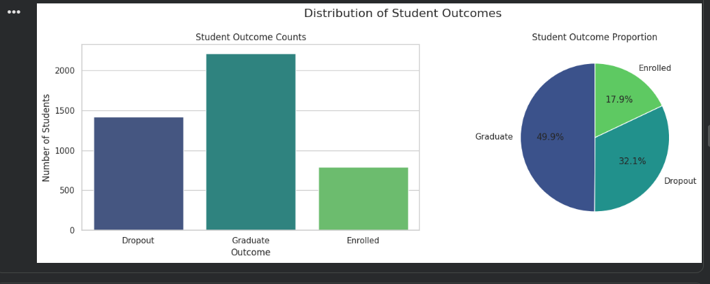

**Approved units by outcome (1st & 2nd semester)**
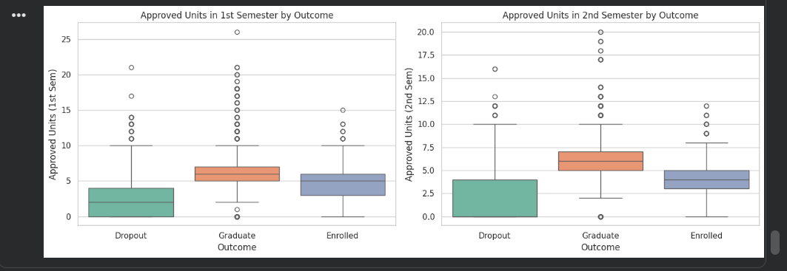

**Age, scholarship and tuition fees vs outcome**
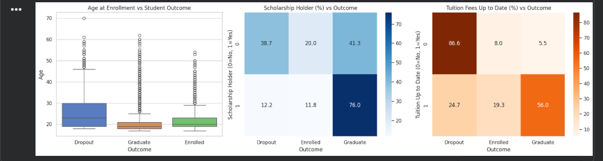

**Correlation matrix of key features**
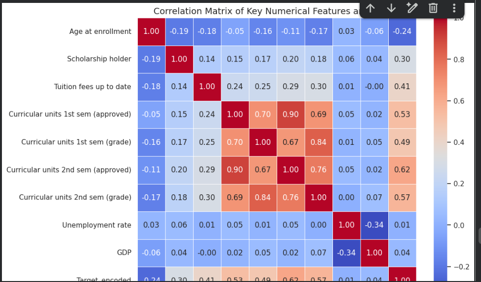

</details>

---

## 🤖 Selected Algorithm: Logistic Regression

Logistic Regression models the probability that a student belongs to the positive class (*Dropout*) by passing a weighted sum of the features through the **sigmoid** function:

$$
P(\text{Dropout} \mid x) = \sigma(w^\top x + b) = \frac{1}{1 + e^{-(w^\top x + b)}}
$$

### Why Logistic Regression?

| ✅ Strength | Why it matters here |
|------------|---------------------|
| **Outputs probabilities** | Gives a *risk percentage*, not just a yes/no answer, which is ideal for risk levels. |
| **Interpretable** | Each coefficient shows how a feature pushes risk up or down, which is easy to explain to educators. |
| **Strong baseline** | Fast to train and reliable on tabular data with a few thousand rows. |
| **Lightweight** | The saved model is only about 6 KB, so predictions in the web app are instant. |

**Configuration:** `LogisticRegression(max_iter=1000, random_state=42)` (L2 penalty, `lbfgs` solver).

---

## ⚖️ Binary Classification Approach

The original three-class target was reduced to a **binary** problem focused on the question that matters most: *"Will this student drop out?"*

```python
# Dropout -> 1, Enrolled and Graduate -> 0
y_binary = df['Target'].apply(lambda x: 1 if x == 'Dropout' else 0)
```

| Original label | Binary label | Meaning |
|----------------|:------------:|---------|
| Dropout | **1** | At risk: positive class |
| Enrolled | **0** | Still studying: non-dropout |
| Graduate | **0** | Completed: non-dropout |

Resulting class balance: **1,421 Dropout (32 %)** vs **3,003 Non-Dropout (68 %)**.

---

## 🏋️ Model Training (80/20 Split)

```python
X_train, X_test, y_train, y_test = train_test_split(
    X_raw, y_binary,
    test_size=0.2,        # 80 % train / 20 % test
    random_state=42,      # reproducible
    stratify=y_binary     # keeps the 32/68 class ratio in both sets
)

scaler_binary = StandardScaler()
X_train_scaled = scaler_binary.fit_transform(X_train)   # fit on train only
X_test_scaled  = scaler_binary.transform(X_test)

log_reg = LogisticRegression(max_iter=1000, random_state=42)
log_reg.fit(X_train_scaled, y_train)
```

| Set | Samples | Features |
|-----|--------:|---------:|
| Training | 3,539 | 36 |
| Testing | 885 | 36 |

---

## 📈 Model Evaluation

### Headline metrics

<div align="center">

| Metric | Score |
|--------|:-----:|
| 🎯 **Test accuracy** | **88.59 %** |
| 🏋️ Training accuracy | 87.71 % |
| 📐 **ROC-AUC** | **0.9266** |

</div>

Training and test accuracy are almost the same, so the model is **not overfitting**.

### Classification report (test set)

| Class | Precision | Recall | F1-score | Support |
|-------|:---------:|:------:|:--------:|:-------:|
| Non-Dropout (0) | 0.88 | 0.96 | 0.92 | 601 |
| **Dropout (1)** | **0.89** | **0.74** | **0.81** | 284 |
| *Macro avg* | 0.89 | 0.85 | 0.86 | 885 |
| *Weighted avg* | 0.89 | 0.89 | 0.88 | 885 |

### Confusion matrix

|  | **Predicted Non-Dropout** | **Predicted Dropout** |
|---|:---:|:---:|
| **Actual Non-Dropout** | ✅ **575** (TN) | ⚠️ 26 (FP) |
| **Actual Dropout** | ❌ 75 (FN) | ✅ **209** (TP) |

### ROC curve

<div align="center">
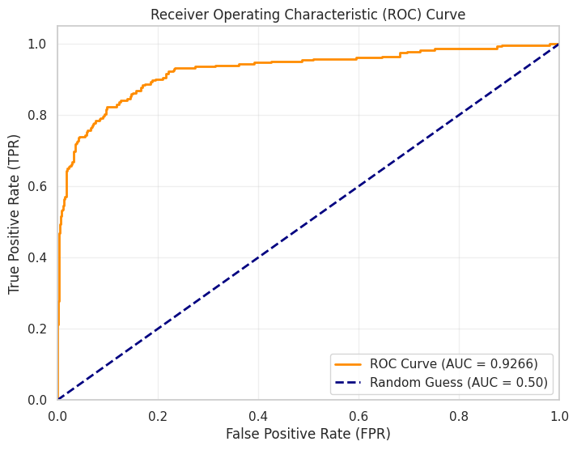
</div>

### What the numbers mean

- **High precision for Dropout (0.89):** when the model flags a student as a dropout risk, it is correct about 9 times out of 10. Few support resources are wasted on false alarms (only **26 false positives**).
- **Moderate recall for Dropout (0.74):** the model catches about 3 in 4 real dropouts. The **75 false negatives** are students it missed, and in this setting a missed at-risk student is the more costly error.
- **ROC-AUC of 0.93:** the model separates dropouts from non-dropouts very well across all thresholds. Lowering the decision threshold below 0.5 would raise recall at a small cost in precision (see [Future Improvements](#-future-improvements)).

---

## 💻 Student Risk Prediction Application

The trained model is served through a responsive **Streamlit** web app ([app.py](app.py)).

### How it works

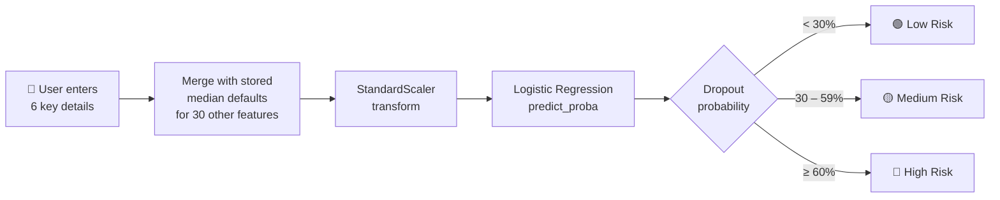

1. **Model bundle:** `trainmodel.pkl` is a joblib bundle containing the fitted `model`, the fitted `scaler`, the ordered `feature_columns`, and the training-set `defaults` (medians), `mins` and `maxs` for each feature.
2. **User input:** the form collects the six most influential, easy-to-obtain fields:

   | Section | Inputs |
   |---------|--------|
   | 👤 Personal Details | Age at Enrollment, Gender |
   | 📚 Academic Information | 1st Semester Approved Units, 2nd Semester Approved Units |
   | 💰 Financial Information | Scholarship Holder, Tuition Fees Up to Date |

3. **Feature vector:** the six inputs are combined with the stored **median** values for the remaining 30 features. This is the same approach the notebook uses for its test profiles.
4. **Prediction:** the vector is scaled with the saved scaler and passed to `predict_proba`, which returns the dropout probability.
5. **Risk classification and display:** the probability is shown on a **semicircle gauge**, colour-coded and labelled as follows:

   | Risk level | Probability |
   |------------|:-----------:|
   | 🟢 **Low Risk** | < 30 % |
   | 🟡 **Medium Risk** | 30 % – 59 % |
   | 🔴 **High Risk** | ≥ 60 % |

### Example predictions

These come from the three test profiles in the notebook. They also set the semester **grades**, so the app, which uses median grades, can give slightly different values for the same inputs.

| Profile | Age | Fees paid | Scholarship | Approved units (S1 / S2) | Dropout probability | Risk |
|---------|:---:|:---------:|:-----------:|:------------------------:|:-------------------:|:----:|
| 🟢 Strong student | 19 | ✅ | ✅ | 6 / 6 | **3.0 %** | Low |
| 🔴 Struggling student | 25 | ✅ | ❌ | 3 / 2 | **67.1 %** | High |
| 🔴 At-risk student | 28 | ❌ | ❌ | 0 / 0 | **99.5 %** | High |

### App features

- 🎨 Clean dashboard UI with a gradient banner, card layout and custom SVG icons
- 📱 **Fully responsive:** side-by-side cards on desktop, stacked cards on tablets, and single-column inputs plus a list-style risk guide on phones
- 🎯 Animated, colour-coded probability gauge
- 🧭 Risk guide that highlights the active risk level
- 🔔 Notice when inputs have changed since the last prediction
- ⚡ Model loaded once with `@st.cache_resource` for fast predictions

---

## ⚙️ Installation & Running the App

### Prerequisites

- **Python 3.11+**
- `pip`

### 1. Clone or download the project

```bash
git clone <your-repo-url>
cd Studentdropout
```

### 2. (Recommended) Create a virtual environment

```bash
python -m venv venv

# Windows
venv\Scripts\activate
# macOS / Linux
source venv/bin/activate
```

### 3. Install dependencies

```bash
pip install -r requirements.txt
```

| Package | Purpose |
|---------|---------|
| `streamlit` | Web application framework |
| `scikit-learn==1.6.1` | Model and scaler (pinned to the version used for training) |
| `joblib` | Loading the saved model bundle |
| `pandas`, `numpy` | Data handling |

### 4. Run the app

```bash
python -m streamlit run app.py
```

Then open **http://localhost:8501** in your browser.

> 🛠️ **Troubleshooting:** if you see `streamlit : The term 'streamlit' is not recognized`, the Streamlit executable is not on your PATH. Use `python -m streamlit run app.py` as shown above.

### 5. (Optional) Re-run the notebook

Open `StudentDropout.ipynb` in Jupyter or Google Colab. It also needs `ucimlrepo`, `seaborn` and `matplotlib`:

```bash
pip install ucimlrepo seaborn matplotlib jupyter
```

---

## 🗂️ Project Structure

```
Studentdropout/
├── app.py                  # Streamlit application
├── style.css               # Responsive UI styles
├── trainmodel.pkl          # Saved model bundle (model + scaler + feature metadata)
├── StudentDropout.ipynb    # Notebook: data, EDA, preprocessing, training, evaluation
├── requirements.txt        # Python dependencies
├── .streamlit/
│   └── config.toml         # Light theme and Inter font
├── screenshort/            # Screenshots used in this README
└── README.md
```

---

## 🖼️ Screenshots

### 1. Data loading

| Dataset preview | Shape & schema |
|:---:|:---:|
| 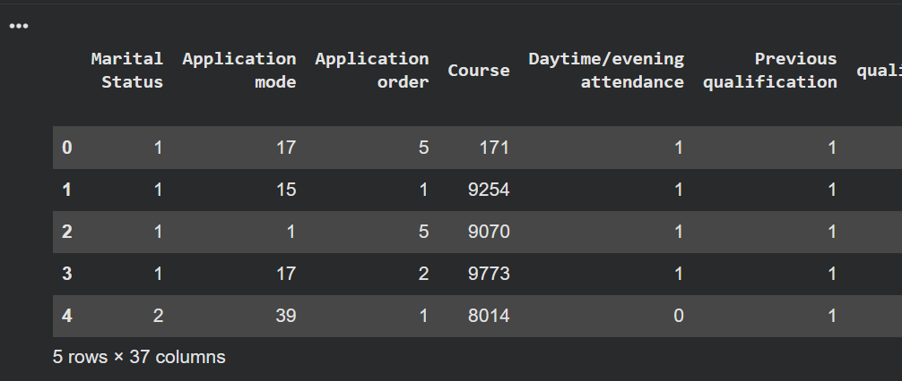 | 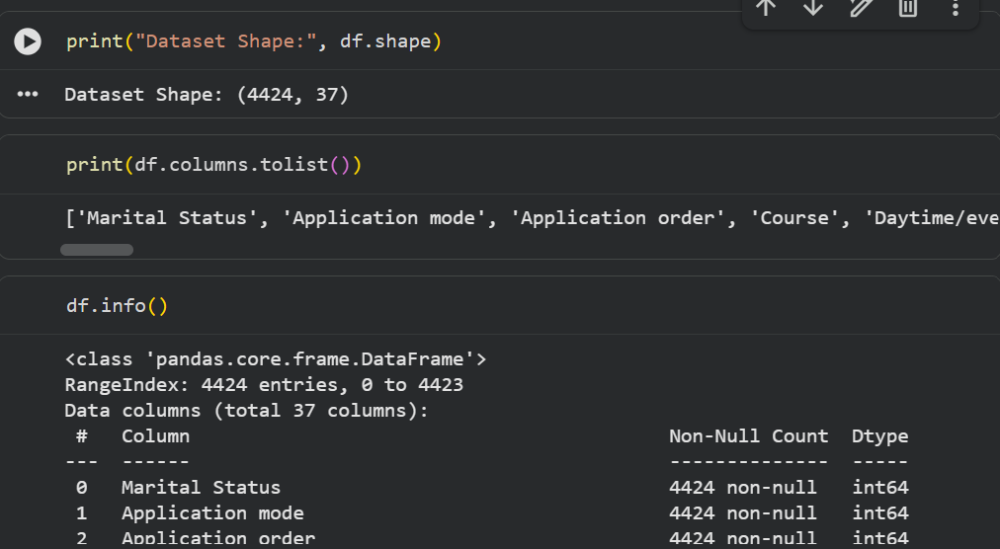 |

### 2. Data inspection & target distribution

| Data types & target counts | Outcome count plot |
|:---:|:---:|
| 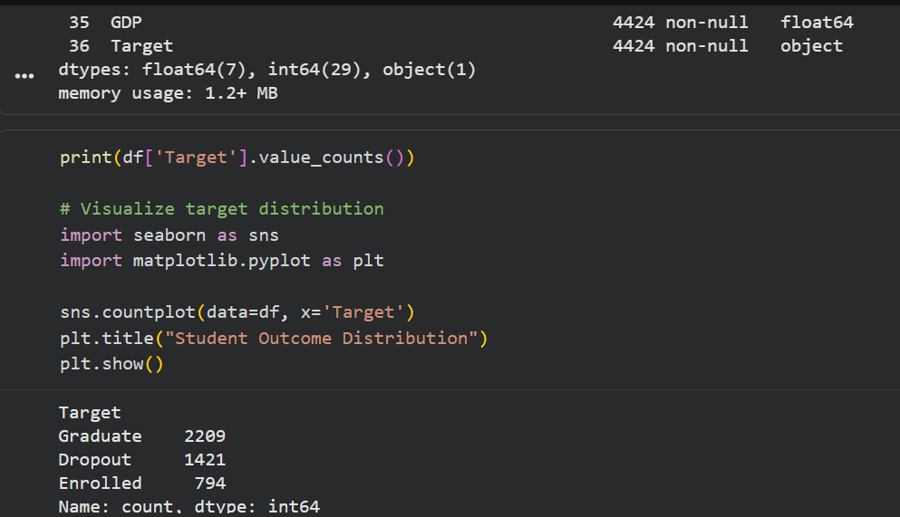 | 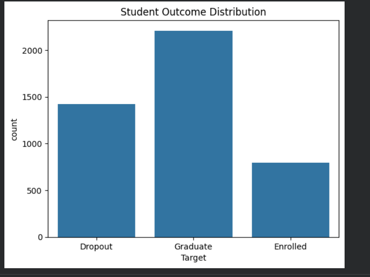 |

### 3. Exploratory data analysis

| Outcome distribution | Approved units by outcome |
|:---:|:---:|
|  |  |

| Age, scholarship & tuition vs outcome | Correlation matrix |
|:---:|:---:|
|  |  |

### 4. Model evaluation

<div align="center">

</div>

### 5. Web application

| Desktop | Mobile |
|:---:|:---:|
|  | 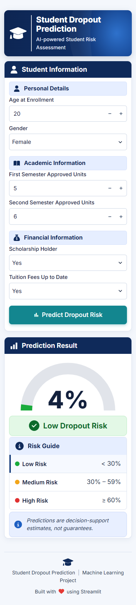 |

---

## 🏁 Conclusion & Future Improvements

### Conclusion

This project shows that a **simple, interpretable model** can be an effective early-warning tool for student dropout:

- ✅ The Logistic Regression model reached **88.6 % test accuracy** and a **ROC-AUC of 0.93**, with no sign of overfitting.
- ✅ **Academic progress** (approved units, especially in the 2nd semester) and **financial standing** (tuition fees, scholarship) are the strongest predictors of dropout.
- ✅ When the model flags a student, it is right **89 %** of the time, so advisors can trust its alerts.
- ✅ The Streamlit app turns the model into a **practical decision-support tool** that gives a clear risk level in seconds.

> ⚠️ Predictions are **decision-support estimates, not guarantees**. They should guide conversations with students, not replace human judgement.

### 🚀 Future Improvements

| Area | Improvement |
|------|-------------|
| 🎯 **Recall** | Tune the decision threshold or use `class_weight='balanced'` to catch more of the 26 % of dropouts that are currently missed. |
| 🌲 **Models** | Compare with Random Forest, XGBoost, LightGBM and SVM, and tune them with cross-validated grid search. |
| 🔁 **Validation** | Use stratified k-fold cross-validation for more robust performance estimates. |
| 🧠 **Explainability** | Add SHAP values to show *why* each student received their score. |
| 📝 **More inputs** | Expose more features in the app (grades, debtor status, admission grade) instead of using median defaults. |
| 🧪 **Multi-class** | Predict all three outcomes (Dropout / Enrolled / Graduate) for a more detailed view. |
| 📂 **Batch scoring** | Allow a CSV upload to score a whole cohort and export a ranked at-risk list. |
| ☁️ **Deployment** | Deploy to Streamlit Community Cloud and add monitoring for data drift. |
| ⚖️ **Fairness** | Audit predictions across gender, age and nationality groups for bias. |

---

<div align="center">

**🎓 Student Dropout Prediction | Machine Learning Project**

Built with ❤️ using Python, scikit-learn & Streamlit

⭐ *If you found this project useful, consider giving it a star!*

</div>
